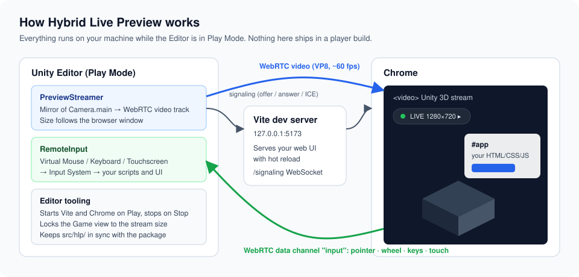
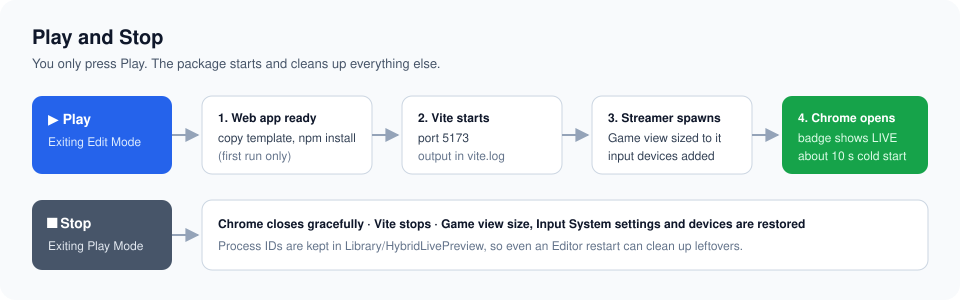
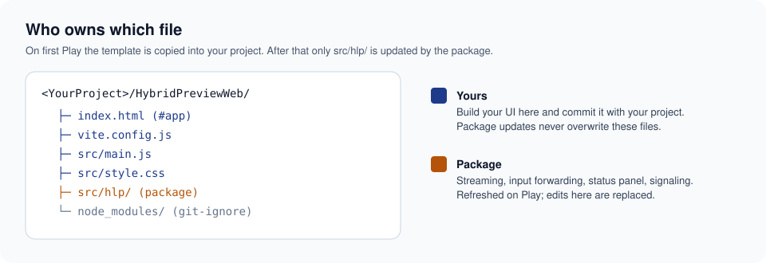
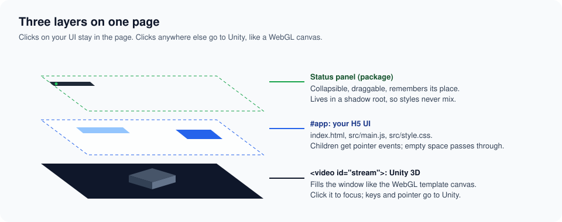

# Hybrid Live Preview for Unity

[English](README.md) · [繁體中文](README.zh-TW.md)

在 Unity 3D 場景上疊一層 HTML5 UI，一邊開發一邊即時看到結果。在 Unity Editor 按下 **Play**，Chrome 就會開啟，畫面就像跑 WebGL Build 一樣：3D 畫面透過 WebRTC 串流，你自己的 HTML／CSS／JS 疊在上面並支援 Vite 熱更新，滑鼠、鍵盤和觸控也會傳回 Unity。

不用打包 WebGL、不用等。改完 C# 或 CSS 直接看。



## 功能

- **一鍵啟動**：Play 時自動啟動 Vite 和專用的 Chrome 視窗；Stop 時全部關閉，並還原所有改過的設定。
- **跟 WebGL Build 一樣的畫面**：串流解析度跟著瀏覽器視窗大小與比例，上限是 *Player Settings → WebGL → Default Canvas Width／Height*，並像 WebGL 範本的 canvas 一樣填滿視窗。Game view 也會鎖成相同解析度，`Screen`、相機比例和 UI 版面都一致。
- **跟 Game view 完全相同的畫面**：串流直接複製 Game view 的最終畫面，反射、後製特效、相機堆疊和 Screen Space - Overlay 的 Canvas 在 Chrome 裡看起來都一樣。
- **真正的 HTML UI**：網頁是由 Vite 提供的一般 HTML／CSS／JS，疊在 3D 畫面上，要用什麼框架都可以。
- **輸入傳回 Unity**：在 3D 畫面上的滑鼠、筆、觸控、滾輪和鍵盤，會注入 Input System 的虛擬裝置，`Mouse.current`、`Keyboard.current`、`Touchscreen.current`、Input Actions 和 `InputSystemUIInputModule` 都收得到。`Cursor.lockState` 會變成瀏覽器的 Pointer Lock。
- **單一資料通道**：`HybridBridge`（C#）和 `window.HybridBridge`（網頁）互傳帶類型的 JSON 訊息，同一套 API 在預覽和 WebGL Build（透過 jslib）都能用。
- **一鍵產出成品**：*Build WebGL* 會 Build Unity Player 和你的 Vite 網頁並合併，成品的行為和預覽一致。
- **不會進到 Build**：除了小小的橋接組件和 WebGL 頁面組件，其他都只在 Editor 編譯。

## 需求

| | |
|---|---|
| Unity | 6000.3 以上（Windows、Direct3D 12 實測） |
| Active Input Handling | *Input System Package* 或 *Both*（輸入轉發需要） |
| Node.js | 18 以上，`npm` 要在 PATH 裡 |
| 瀏覽器 | Google Chrome |
| Unity 模組 | *WebGL Build Support*（只有 **Build WebGL** 需要） |

套件依賴 `com.unity.webrtc` 3.0.0 和 `com.unity.inputsystem` 1.11.2 以上，Unity 會自動安裝。

### 任何專案都能直接用

套件裡沒有任何綁定特定專案的內容，換專案時不需要搬移、改名或設定任何東西：

- 第一次 Play 或 Build 時，會自動在專案根目錄建立 `HybridPreviewWeb/`。套件只維護 `src/hlp/`，不會動到你自己的檔案。
- 產品名稱、公司、版本和 canvas 上限，都讀取該專案的 Player Settings。
- Unity Build 的檔名（Build 名稱、*Name Files As Hashes*、Brotli／Gzip／不壓縮）在每次 Build 後自動判斷，不寫死。
- Build 時使用 Build Profile 列出的場景；沒有列的話就用目前開著的場景。
- 暫存檔放在 `Library/HybridLivePreview/`，成品放在 `Builds/HybridWebGL/<版號>/`，都在專案內。

範本一開始的兩樣東西請保留：`index.html` 裡的 `<video id="stream">`，以及 `src/main.js` 裡的 `startHybridPreview(...)` 呼叫。頁面其他部分都由你自由安排。

## 安裝

在 Unity 開啟 **Window → Package Manager → + → Install package from git URL…**，輸入：

```
https://github.com/RyanXuwei/unity-hybrid-live-preview.git#main
```

或加進 `Packages/manifest.json`：

```json
"com.ryanxuwei.hybrid-live-preview": "https://github.com/RyanXuwei/unity-hybrid-live-preview.git#main"
```

要固定版本，把 `#main` 換成 tag，例如 `#v0.8.0`。

## 快速開始

1. 開啟場景，按 **Play**。（只有 *Mirror Camera* 擷取模式才需要 **MainCamera** 標籤的相機。）
2. 第一次會把網頁範本複製到 `<專案>/HybridPreviewWeb/` 並執行 `npm install`（約一分鐘）。
3. Chrome 開啟 `http://127.0.0.1:5173/`，角落的狀態小標籤變綠並顯示 **LIVE** 和串流解析度。
4. 先點一下 3D 畫面取得焦點，之後就能像在 WebGL Build 裡一樣用滑鼠和鍵盤操作。
5. 按 **Stop**，Chrome 和 Vite 會關閉，Game view 也會回到原本的大小。



## 開發自己的 UI

UI 放在 `<專案>/HybridPreviewWeb/`，請跟專案一起納入版控，並忽略 `node_modules/`。



在 `index.html` 的 `#app` 裡放 HTML：

```html
<main class="stage">
  <video id="stream" autoplay playsinline muted tabindex="-1"></video>
  <div id="app">
    <button class="my-button">開始</button>
  </div>
</main>
```

在 `src/main.js` 寫程式：

```js
import './style.css';
import { startHybridPreview } from './hlp/index.js';

const preview = startHybridPreview(document.getElementById('stream'));

document.querySelector('.my-button').addEventListener('click', () => {
  console.log('這個點擊留在網頁，不會傳進 Unity', preview.peer);
});
```

`#app` 的直接子元素會接收點擊，其他空白處的輸入會穿透到 3D 畫面。存檔後 Vite 會自動重新整理，串流也會自己重新連線。



### 狀態浮動框

角落的小標籤是套件提供的狀態框：拖曳標題列移動，點 **▸** 或雙擊展開連線與串流資訊，位置會記住。它在 Shadow DOM 裡，你的 CSS 不會影響它，它也不會影響你的 UI。要完全隱藏：

```js
startHybridPreview(document.getElementById('stream'), { panel: false });
```

`startHybridPreview` 會回傳即時連線狀態（也可從 `window.__hlp` 取得）：`signaling`、`unity`、`peer`、`codec`、`width`、`height`、`fps`、`framesDecoded`。

## 在 Unity 腳本讀取輸入

用 Input System 讀輸入，Editor 和瀏覽器的操作都收得到：

```csharp
using UnityEngine;
using UnityEngine.InputSystem;

public class Spin : MonoBehaviour
{
    InputAction drag;

    void Awake() => drag = new InputAction(binding: "<Mouse>/delta");
    void OnEnable() => drag.Enable();
    void OnDisable() => drag.Disable();

    void Update()
    {
        if (Mouse.current != null && Mouse.current.leftButton.isPressed)
            transform.Rotate(Vector3.up, -drag.ReadValue<Vector2>().x * 0.2f);
    }
}
```

舊版的 `UnityEngine.Input`（`Input.GetMouseButton`、`Input.GetKey`…）在 Editor 裡只讀得到取得焦點時的實體裝置，沒辦法接收轉發的輸入，請改用 Input System。

預覽執行期間，因為焦點在 Chrome 而不是 Editor，套件會暫時把 Input System 的 *Background Behavior* 設成 *Ignore Focus*，並把所有裝置輸入導向 Game view。Stop 時兩個設定都會還原。

## 網頁與 Unity 互傳資料（HybridBridge）

`HybridBridge` 是 H5 網頁和 Unity 之間唯一的資料通道，兩邊各只有一個全域入口：C# 的靜態類別 `HybridBridge`，以及網頁的 `window.HybridBridge`。一則訊息由「類型名稱＋JSON 內容」組成。同一份程式碼在 Editor 預覽（走 WebRTC DataChannel）和 WebGL Build（走 `HybridBridge.jslib`）都能直接執行，差別只在底下的傳輸層。

網頁端（任何腳本都能用，不需要 import）：

```js
HybridBridge.send('door', { id: 'A1', open: true });

const off = HybridBridge.on('sensor', (data) => {
  document.querySelector('#temp').textContent = data.celsius;
});
// 呼叫 off() 停止接收。
```

Unity 端：

```csharp
using System;
using RyanXuWei.HybridLivePreview;
using UnityEngine;

public class Door : MonoBehaviour
{
    [Serializable] class DoorCommand { public string id; public bool open; }
    [Serializable] class Reading { public float celsius; }

    IDisposable subscription;

    void OnEnable() => subscription = HybridBridge.On<DoorCommand>("door", cmd => Debug.Log($"{cmd.id} open={cmd.open}"));
    void OnDisable() => subscription?.Dispose();

    void Report(float celsius) => HybridBridge.Send("sensor", new Reading { celsius = celsius });
}
```

| C# | 網頁 | 說明 |
|---|---|---|
| `HybridBridge.Send(type, payload)` | `HybridBridge.send(type, payload)` | C# 的內容用 `JsonUtility` 序列化（`[Serializable]` 的 class 或 struct）。`HybridBridge.Send(type)` 不帶內容。 |
| `HybridBridge.SendJson(type, json)` | | 內容已經是 JSON 時使用（陣列、字串、數字…）。 |
| `HybridBridge.On<T>(type, handler)` | `HybridBridge.on(type, (payload, type) => …)` | C# 回傳 `IDisposable`，網頁回傳 `off()` 函式。 |
| `HybridBridge.OnJson(type, handler)` | `HybridBridge.off(type, handler)` | `OnJson` 直接拿到原始 JSON 字串。 |
| `HybridBridge.IsConnected` | `HybridBridge.connected` | 另一端目前是否連得到。 |

- 兩邊隨時都能送。另一端還沒連上時，訊息會先排隊（最多 256 則，滿了就丟最舊的），連上後再送達。
- 沒有人接收的訊息會被丟棄，Unity 對每種未知類型只會警告一次。請在 `OnEnable` 訂閱；網頁載入時主動向 Unity 要需要的狀態（例如 `HybridBridge.send('getState')`），不要依賴網頁出現之前送出的訊息。
- 橋接組件 `RyanXuWei.HybridLivePreview.Bridge` 會自動被專案參考，也是本套件唯一會打包進 Player 的部分。

## 產出最終 WebGL 網站

**Tools → Hybrid Live Preview → Build WebGL (Unity + Web UI)** 一鍵產出可部署的成品：

1. Build Unity WebGL Player（使用 Build Profile 列出的場景；沒有列的話就用目前開著的場景）。
2. 以你的 `vite.config.js` 為基礎，用 Vite Build `HybridPreviewWeb`。
3. 兩者合併到 `<專案>/Builds/HybridWebGL/<版號>/`（版號取自 Player Settings，不同版號的 Build 不會互相覆蓋）：你的 `index.html`、`assets/`，加上 Unity WebGL 範本產出的其他檔案：`Build/`、`StreamingAssets/`、`TemplateData/`，以及範本自帶的自訂檔案（例如 `environmentSetting.js`）。頁面本身是 WebGL 範本的 `index.html` 加上你的 UI（見下方「Build 頁面」）。

從 Play 到正式 Build，你的 UI 程式碼完全不用改：`HybridBridge` 改走 jslib，`#app` 疊在 Unity canvas 上面。和預覽一樣，canvas 要先點一下才會接收鍵盤，所以 UI 裡的輸入框照常可用。

### Build 頁面

**Tools → Hybrid Live Preview → Web Build Page** 決定最終 `index.html` 怎麼產生：

- **Inject Into WebGL Template**（預設）：Player Settings 選的 WebGL 範本的 `index.html` 維持原樣當作頁面，範本的 canvas、載入器、腳本、Service Worker 與樣式都照你在範本裡設計的。套件只補上 UI 需要的東西：你的腳本與樣式加進 `<head>`，`#app` 圖層加到 `<body>` 結尾、疊在 Unity canvas 上面。想自己指定這兩個位置，可以在範本放 `<!-- HLP:head -->` 與 `<!-- HLP:body -->`；沒放的話就插在 `</head>` 與 `</body>` 之前。範本不需要預留任何佔位，你的 `HybridPreviewWeb/index.html` 也不會覆蓋它。
- **Replace WebGL Template Page**：由 `HybridPreviewWeb/index.html` 當頁面，`startHybridPreview` 在取代預覽 video 的 canvas 裡啟動 Unity。如果範本的 `index.html` 有額外初始化，請把那幾行搬進你的 `index.html`。

這個圖層和預覽時一樣是 `pointer-events: none`，點擊會穿透到 Unity，只有設了 `pointer-events: auto` 的元素會接收點擊。

**Preview WebGL Build** 會在 `http://127.0.0.1:4173/` 架起這個資料夾，並用預覽用的 Chrome 開啟。如果用 Brotli 或 Gzip 壓縮且沒開 *Decompression Fallback*，網站伺服器必須替 `Build/*.br`、`*.gz` 加上 `Content-Encoding` 標頭（預覽伺服器會自動處理），也不能直接從硬碟開 index.html。

## 選單

**Tools → Hybrid Live Preview**

| 項目 | 功能 |
|---|---|
| Auto Launch On Play | 開關整個預覽功能 |
| Match Game View To Preview | Play 時把 Game view 鎖成串流解析度 |
| Capture → Game View Output／Mirror Camera (Fallback) | **Game View Output**（預設）直接串流 Game view 的畫面。**Mirror Camera** 會用 `Camera.main` 再渲染一次，Game view 被遮住時也能繼續串流，但只替主相機計算的效果（例如平面反射）可能對不上。下次 Play 時生效 |
| Open Preview In Chrome | 重新開啟預覽視窗 |
| Build WebGL (Unity + Web UI) | Build Unity Player 和網頁，合併到 `Builds/HybridWebGL/<版號>` |
| Preview WebGL Build | 在 `http://127.0.0.1:4173/` 架起上一次的成品，並用 Chrome 開啟 |
| Install Web App | 立即複製範本並執行 `npm install` |
| Stop Vite And Chrome | 關閉殘留的程序 |
| About | 在 Console 顯示目前版本 |

## 結構

| 資料夾 | 組件 | 用途 |
|---|---|---|
| `Editor/` | `RyanXuWei.HybridLivePreview.Editor`（Editor 平台） | Play／Stop 生命週期、Vite 與 Chrome 程序、Game view 解析度、網頁安裝與同步 |
| `Streaming/` | `RyanXuWei.HybridLivePreview.Streaming`（僅 `UNITY_EDITOR`） | `PreviewStreamer`：擷取 Game view（或鏡像相機）、WebRTC 視訊軌、DataChannel；預覽用的橋接傳輸層 |
| `Bridge/` | `RyanXuWei.HybridLivePreview.Bridge`（所有平台，自動參考） | `HybridBridge` API；WebGL Build 用的 `HybridBridge.jslib` 與傳輸層 |
| `WebGL/` | `RyanXuWei.HybridLivePreview.WebGL`（僅 WebGL Player） | 在 Build WebGL 產出的網站裡，讓 canvas 和頁面共用鍵盤 |
| `Input/` | `RyanXuWei.HybridLivePreview.Input`（`UNITY_EDITOR` + `ENABLE_INPUT_SYSTEM`） | `RemoteInput`：把瀏覽器輸入注入 Input System 虛擬裝置 |
| `WebApp~/` | （Unity 不匯入） | Vite 範本、signaling 中繼、viewer、狀態浮動框 |

執行時的檔案放在 `<專案>/Library/HybridLivePreview/`：`vite.log`、Chrome 設定檔，以及用來清理程序的 PID 檔。

## 疑難排解

- **狀態框顯示「Vite offline」**：查看 `Library/HybridLivePreview/vite.log`，確認新開的終端機能執行 `node` 和 `npm`，且 5173 埠沒被佔用。
- **一直顯示「Waiting for Unity Play」**：確認場景有 MainCamera 標籤的相機，Console 有出現 `[HybridLivePreview] Signaling connected`。
- **輸入沒反應**：先點一下 3D 畫面取得鍵盤焦點；Active Input Handling 要是 *Input System Package* 或 *Both*；腳本要用 Input System 讀輸入。
- **編輯器沒有焦點時輸入失效或畫面凍結**：預覽在 Play 期間會自動開啟 *Run In Background*。另外請檢查 Game view 工具列的 Play Mode 必須是 *Play Focused*（選 *Play Unfocused* 會讓鍵盤輸入失效）。
- **預覽畫面凍結**：Game view 被其他分頁蓋住時，Unity 會停止渲染它，Console 也會出現警告。請讓 Game view 保持可見，或把 *Capture* 切到 *Mirror Camera*。
- **只有 Chrome 裡的反射或特效不對**：*Capture* 目前是 *Mirror Camera*，切回 *Game View Output* 即可。
- **Console 警告目前的 Build Profile 不是 Web**：本套件只支援 Web 輸出，請在 *File > Build Profiles* 切換到 Web 平台；按 **Build WebGL** 時也會詢問是否幫你切換。
- **找不到 Chrome**：會改開預設瀏覽器。Chrome 裝在特殊位置時，可用 `EditorPrefs` 的 `RyanXuWei.HybridLivePreview.ChromePath` 指定路徑。

## 為什麼不用 Unity Render Streaming？

`com.unity.renderstreaming` 3.1.0-exp.9 在 Unity 6000.3 編譯不過（使用了已移除的 `AndroidApiLevel22`）。本套件直接使用 `com.unity.webrtc` 3.0.0，並在 Vite dev server 裡內建一個小型 signaling 中繼。

## 給 AI 助手

兩份 Markdown 手冊讓任何 AI 助手都能快速理解這個混合架構：

- [`WebApp~/src/hlp/AI-GUIDE.md`](WebApp~/src/hlp/AI-GUIDE.md)：用套件開發應用（檔案歸屬、頁面版面、HybridBridge 規則、做法範例、疑難排解）。它會複製到每個專案的 `HybridPreviewWeb/src/hlp/AI-GUIDE.md`，請 AI 先讀這份。
- [`AGENTS.md`](AGENTS.md)：修改套件本身。

## 授權

[MIT](LICENSE) © Ryan Hsu
